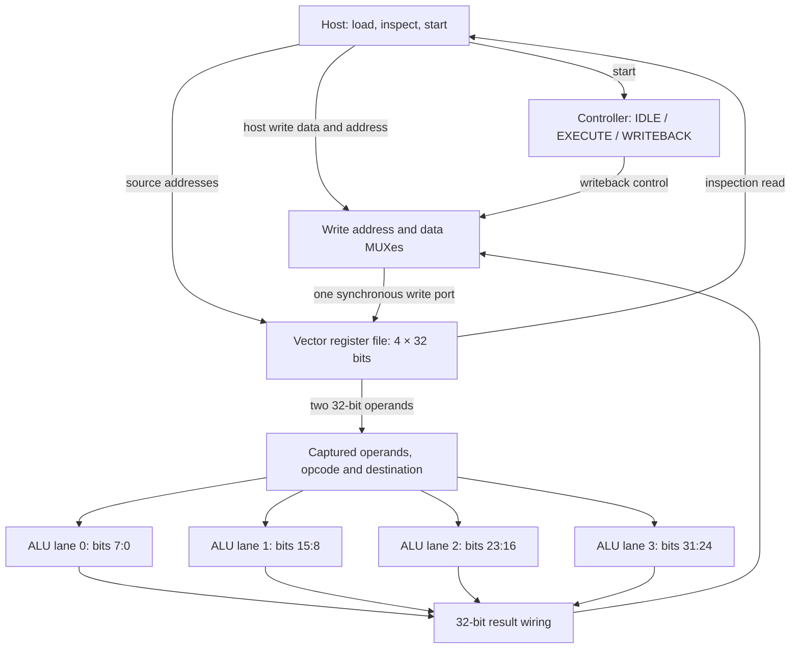

# SIMD architecture

The prototype executes one operation on four independent 8-bit elements. A single
3-bit opcode controls four physical ALU instances. The top-level module is
[`simd_top`](../rtl/simd_top.v).

## Datapath

The result combiner is wiring: each lane drives its own result slice.
There is no horizontal sum, carry propagation between lanes, or lane-to-lane
communication. Opcode and destination are captured alongside the operands;
the same captured opcode reaches every lane.

## Module hierarchy

| Module | Instances | Responsibility |
|---|---:|---|
| `simd_top` | 1 | Operand capture, host arbitration, lane slicing and result packing |
| `vector_regfile` | 1 | Four 32-bit registers, two asynchronous reads, one synchronous write |
| `vector_control` | 1 | Three-state execution sequence, busy indication and completion pulse |
| `alu_lane` | 4 | Combinational 8-bit arithmetic, logic and unsigned comparison |

The register file stores 128 data bits. The top level additionally stores two
32-bit operands, a 3-bit opcode and a 2-bit destination. These are logical RTL
storage counts, not measured FPGA utilization.

## Vector representation and instruction fields

| Field | Meaning |
|---|---|
| `src_a[1:0]`, `src_b[1:0]` | Source vector register indices, 0–3 |
| `dst[1:0]` | Destination vector register index, 0–3 |
| `opcode[2:0]` | Shared lane operation |
| Lane 0 / 1 / 2 / 3 | Bits [7:0] / [15:8] / [23:16] / [31:24] |

| Opcode | Operation in each lane |
|---|---|
| 000 | ADD, low 8 bits of a + b |
| 001 | SUB, low 8 bits of a − b |
| 010 | Bitwise AND |
| 011 | Bitwise OR |
| 100 | Unsigned a < b, returned as 8-bit 0 or 1 |
| 101–111 | Zero result |

For example, ADD of `0xFF800003` and `0x0180FF05` produces
`0x0000FF08`. Each byte adds independently; an overflow in one lane does
not affect the next lane.

## Host interface contract

1. Apply synchronous reset across a rising clock edge before use.
2. While `busy=0` and `start=0`, assert `host_write_enable` with
   address/data for a rising edge to load a vector register.
3. Set source indices, destination and opcode before asserting `start`
   across an idle rising edge. Start takes priority over a simultaneous host write.
4. After acceptance, instruction inputs may change: captured values drive execution.
5. Wait for `done=1`, then inspect the destination using `host_read_addr`
   with `start=0`.

Host writes while busy are discarded, not queued. Writeback has priority at
the register-file write port. Reset clears all vector registers and cancels
an in-flight operation.

The host read output directly shares register-file read port A. Whenever
`accept=start && !busy && !reset` is true, it shows `src_a`, rather than
`host_read_addr`. For predictable inspection, keep `start=0`.
Reading is combinational; there is no read-valid handshake.

See [execution timing and Proposed Solution](proposed_solution.md) for
the controller sequence and quantitative limits.
