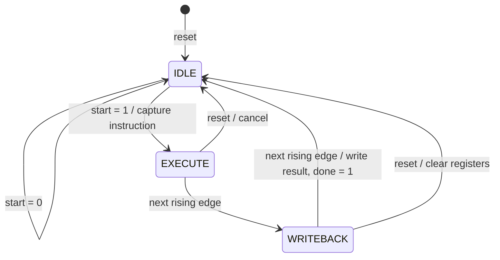

# Proposed Solution and microarchitecture

This is a technical section for incorporation into the Phase I IEEE report.
It is not the complete IEEE-formatted report.

## Proposed Solution

The proposed SIMD vector processing unit uses four parallel 8-bit ALU lanes
to apply a shared operation to a pair of 32-bit vectors. Each vector contains
four independent elements. Four 32-bit vector registers provide operand
and result storage through two asynchronous read ports and one synchronous
write port. The supported operations are addition, subtraction, bitwise AND,
bitwise OR and unsigned less-than comparison. Addition and subtraction wrap
modulo 256 independently in each lane.

A top-level integration module captures both source vectors, the shared
opcode and the destination register index when an idle start request is
accepted. This isolates execution from subsequent changes on instruction
inputs and supports a destination that aliases either source register.
Four instances of the combinational ALU process the captured byte pairs.
The resulting bytes are connected to a 32-bit result bus, which is written
to the captured destination through a writeback multiplexer.

A three-state synchronous controller sequences request acceptance,
execution and writeback. A host interface loads initial register contents
and exposes a register inspection port. Start has priority over an idle
host write; host writes and start requests received while busy are not
queued. Synchronous reset clears storage and suppresses completion of the
cancelled operation. The [architecture diagram](architecture.md) describes
the module hierarchy and data paths.

## Controller states



Reset has priority over all other actions. `done` is a registered pulse,
not a separate state. During the cycle following writeback, the controller
is idle, `busy=0`, and `done=1`. At the next rising edge, `done`
clears and a new instruction may be accepted.

| Rising edge | State after edge | busy | write_enable | done | Action at edge |
|---|---|---:|---:|---:|---|
| E0 | EXECUTE | 1 | 0 | 0 | Accept start; capture operands, opcode and destination |
| E1 | WRITEBACK | 1 | 1 | 0 | Enter writeback; result available combinationally |
| E2 | IDLE | 0 | 0 | 1 | Register file samples the preceding write_enable and stores result |
| E3 | EXECUTE if next start is asserted | 1 if accepted | 0 | 0 | Earliest acceptance of the next instruction |

The register file and controller both use rising-edge-triggered nonblocking
assignments. Thus writing occurs on E2, when the controller leaves WRITEBACK,
rather than on E1 when the write-enable signal becomes high.

A start held high through busy does not create a queued request. If it
remains high at E3, it is treated as a new idle request. A host should pulse
start for a single accepted edge or explicitly deassert it before the next
idle acceptance edge.

## Quantitative interpretation

The following values are derived from the RTL schedule, not synthesis or a
scalar comparison benchmark:

| Metric | Value and boundary |
|---|---|
| Request-to-completion latency | 2 clock periods, from E0 acceptance to E2 writeback |
| Minimum instruction initiation interval | 3 clock periods, E0 to E3 |
| Elements per vector instruction | 4 |
| Peak sustained compute throughput | 4/3 element operations per clock, with operands already resident |
| At a clock frequency f | Latency 2/f seconds; peak throughput 4f/3 element operations per second |

Counting the acceptance edge, execution edge and completion edge gives
three participating rising edges. This must not be confused with the two
elapsed clock periods between acceptance and completion.

Each host vector load takes an additional accepted write edge. Operand
loading, result transfers and any software overhead are excluded from the
compute-only throughput above. Four physical lanes do not by themselves
prove a measured 4× system speed-up. A scalar baseline must use an explicit,
comparable workload and timing boundary. Scalar implementation and benchmark
work remain separate deliverables.

## Verification evidence

The GitHub Actions [simulation run](https://github.com/aanyamehrotra/simd-vector-processing-unit/actions/runs/43481274844)
for implementation commit
[`f58db9b`](https://github.com/aanyamehrotra/simd-vector-processing-unit/commit/f58db9ba5f1cba698a3775492eab553f1fce94d4)
completed successfully using Icarus Verilog.

| Testbench | Observed result | Coverage exercised |
|---|---|---|
| `tb_alu_lane` | 524,317 checks, zero errors | 29 directed checks plus all 8 × 256 × 256 opcode/input combinations |
| `tb_vector_regfile` | PASS | All addresses, read/write timing, disabled write and reset priority |
| `tb_vector_control` | PASS | State sequencing, busy requests, completion and reset cancellation |
| `tb_simd_top` | 1,678 checks, PASS | Five valid operations, reserved opcodes, distinct lanes, arithmetic wraparound, in-place destination, captured inputs, host arbitration and reset in both busy states |

The integrated testbench additionally applies 32 pseudorandom vector pairs
across all eight opcodes. Its assertions check architectural values and
handshake outputs. The counter includes individual read and flag assertions;
it is not a count of independent vector instructions.

The run's `simulation-evidence` artifact contains test logs and VCD files.
The SIMD VCD records the initial directed tests; dumping is disabled before
the pseudorandom sweep to keep the waveform small. Passing assertions
establish the tested behaviour. Manual waveform inspection and screenshots
for the report/video remain to be completed.

To reproduce from the repository root with Icarus Verilog installed:

```sh
mkdir -p build
iverilog -g2012 -Wall -s tb_simd_top -o build/simd_top.vvp rtl/*.v tb/tb_simd_top.v
vvp build/simd_top.vvp
gtkwave tb_simd_top.vcd
```

The final command requires GTKWave and is optional for running assertions.

## Scope and remaining evaluation

The current prototype demonstrates functional SIMD execution in simulation.
It has no instruction memory, cache, external memory controller, pipeline,
lane masks or overflow flags. Comparison is unsigned; it is not a signed
comparison or a full-byte predicate mask.

FPGA part selection, synthesis resource counts, timing constraints, maximum
operating frequency, scalar-versus-SIMD measured speed-up and hardware-board
demonstration have not been produced by this implementation. They must be
reported from actual tools and experiments when completed. The Phase I IEEE
report also still needs its Abstract, Literature Review, actual Individual
Contributions and References, alongside this technical section.
