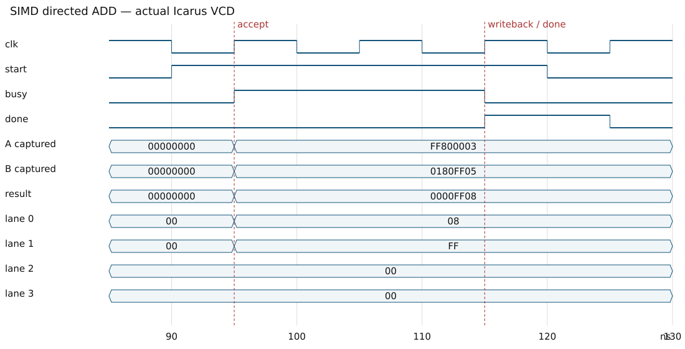

# Waveform verification

The report figure is rendered from the actual Icarus VCD produced by tb_simd_top, not from a manually invented trace.

## Directed transaction

- Captured A = FF800003 and B = 0180FF05.
- Shared operation = ADD (opcode 000).
- Expected packed result = 0000FF08.
- Byte results from lane 0 to lane 3 = 08, FF, 00, 00.
- Request is accepted when idle start is sampled; completion follows two clock periods later.
- All four ALU slices operate on the same captured operands and opcode in parallel.
- Overflow is dropped within each byte; it does not propagate into the next lane.

The red markers identify the first busy assertion and first done pulse in the trace. The figure includes captured operands, the complete result and each lane result. The result bus settles combinationally before the register-file writeback edge.

## Reproduce and inspect

Run bash scripts/run_simulation.sh, then open tb_simd_top.vcd in GTKWave. Add clk, start, busy, done, dut.operand_a, dut.operand_b, dut.vector_result and dut.lanes[0..3].alu.result. Select hexadecimal radix for buses. Inspect reset, directed operations, writeback and done.

For automatic figure generation, run the full build with bash scripts/build_phase1.sh. scripts/collect_evidence.py parses the VCD and checks the directed result and acceptance/completion interval before rendering the figure. It also records the original VCD SHA-256 and marker times in evidence/results.json.

Stored evidence:
- [Original SIMD VCD](../evidence/tb_simd_top.vcd)
- [Vector waveform SVG](../evidence/simd_add_waveform.svg)
- [Vector waveform PDF](../evidence/simd_add_waveform.pdf)
- [Benchmark VCD](../evidence/tb_performance.vcd)
- [Scalar VCD](../evidence/tb_scalar_top.vcd)

Only the initial directed portion is dumped for SIMD/scalar, and the first benchmark trial is dumped for performance. Assertions still cover the full pseudorandom tests. The waveform image supplements the self-checking test results; it is not a proof of all possible behaviors.
